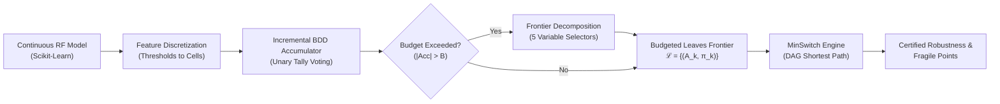

# Formal Verification & Certified Robustness of Random Forests via Budgeted OBDDs

*Symbolic compilation, decomposition limits (scaling walls), and exact input-space robustness verification using Ordered Binary Decision Diagrams (OBDDs).*

---

## 📌 Executive Summary

In this project, I designed, implemented, and empirically evaluated a symbolic verification framework that compiles pre-trained **Random Forest (RF)** classifiers into **Ordered Binary Decision Diagrams (OBDDs)** under strict node-budget constraints.

Random Forests construct non-linear, orthogonal step boundaries across continuous feature spaces. Evaluating formal properties (such as finding the minimum adversarial perturbation) is typically NP-hard. By discretizing the feature space and incrementally compiling ensemble voting relations into OBDDs, I reduced the certified robustness computation to a **polynomial-time DAG shortest-path search (`MinSwitch`)**.

---

## 🚀 Key Contributions

### 1. Symbolic BDD Compilation Engine (`rfbdd/`)
* **Discretization (`discretize.py`)**: Extracted all orthogonal decision thresholds across all ensemble trees and mapped continuous dimensions into mutually exclusive one-hot boolean variables ($v_{j, c} \in \{0, 1\}$).
* **Incremental Composition (`composition.py`, `first_tree.py`, `subsequent_tree.py`)**: Symbolically conjoined successive tree voting relations while existentially quantifying out intermediate state bits:
  $$\text{Acc}_t = \text{let}(\text{sub\_map}, \exists \vec{c} . (\text{Acc}_{t-1} \wedge \phi_t))$$
* **Budgeted Frontier Management (`frontier.py`)**: Enforced a node budget parameter $B$. Whenever $|\text{Acc}_t| > B$, the engine decomposes the accumulator into leaf children, maintaining an active search frontier.
* **Variable Branching Selectors (`selectors.py`)**: Implemented and benchmarked 5 decomposition heuristics:
  1. `modal_variable`: Selects the most frequent variable in the active BDD graph ($O(|G|)$ time).
  2. `random_node`: Uniform random sampling among active nodes.
  3. `info_gain`: Information gain over the reachable assignment space.
  4. `shapley`: Cooperative game-theoretic BDD attribution.
  5. `p_value`: Statistical hypergeometric association test (optimized with a fast normal approximation with finite-population correction for large states).

---

### 2. Empirical Benchmark & Scaling Wall Analysis
I conducted a large-scale empirical evaluation across all **54 benchmark datasets** under budgets $B \in \{50, 100\}$ and all 5 selectors and a timeout of 0.5s:

* **Budget Scaling ($B=50$ vs $B=100$)**:
  * Doubling the budget increased the mean prefix depth from **$4.98$ to $6.53$ trees** ($+31.1\%$ relative improvement).
  * Shifted the scaling wall upward, allowing the accumulator to absorb additional voting relations before decomposition is forced.
* **Selector Performance**:
  * `modal_variable` proved to be the superior heuristic, achieving the highest average reachable depth ($k_{\max} = 7.48$ at $B=100$) and winning 31 out of 54 datasets.
  * Semantic selectors (`info_gain`, `shapley`) achieved high depth on structured datasets but suffered from quadratic decision overhead.
* **Dataset Complexity Taxonomy**:
  * Multi-class datasets ($C \ge 3$) hit early scaling walls ($k \le 2-3$) due to $(C-1)$ unary counter bits required per tree.
  * Low-feature binary datasets ($F \le 10, C=2$) scaled up to $k=44$ trees.
  * Exactly three datasets achieved **100% full forest completion**: `threeOf9` (44 trees), `lupus` (28 trees), and `mammo` (12 trees).

---

### 3. Certified Test-Set Robustness via MinSwitch 
On the 3 fully completed models, I evaluated the exact label robustness for every sample in the held-out test splits (`_test.csv`):

* **Shortest-Path Formulation (`robustness.py`)**:
  * Mapped the sample $\hat{x}$ onto the OBDD leaves.
  * Assigned edge weight $0$ if a branch matches the sample's discrete assignment, and weight $1$ if it requires a bit flip.
  * Solved the minimum Hamming distance problem via DAG shortest path in polynomial time.
* **Certified Metrics**:
  * **Certified Accuracy**: Reached $100\%$ on `threeOf9`, $78.76\%$ on `mammo`, and $88.89\%$ on `lupus` (matching the underlying Random Forest predictions exactly).
  * **Untargeted Radius $\text{rob}_{\text{untargeted}}(\hat{x})$**: Measured the exact distance to the nearest rival decision boundary.
  * **Fragile Instance Detection**: Identified boundary points with $\text{rob} = 1$ (e.g., in `threeOf9`, flipping the single dominant decisive bit strictly inverts the classification).
  * **Feature Attribution**: Discovered which input features are most frequently exploited to cross the decision boundary.

---

## 📜 License
This project is licensed under the [MIT License](LICENSE).